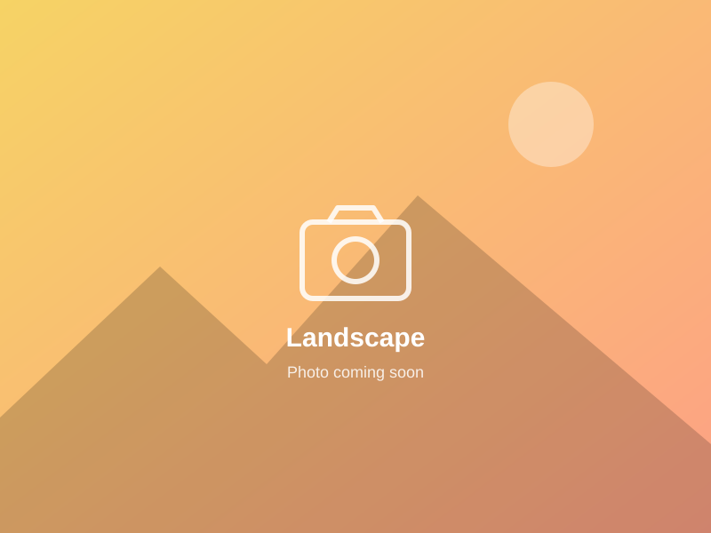
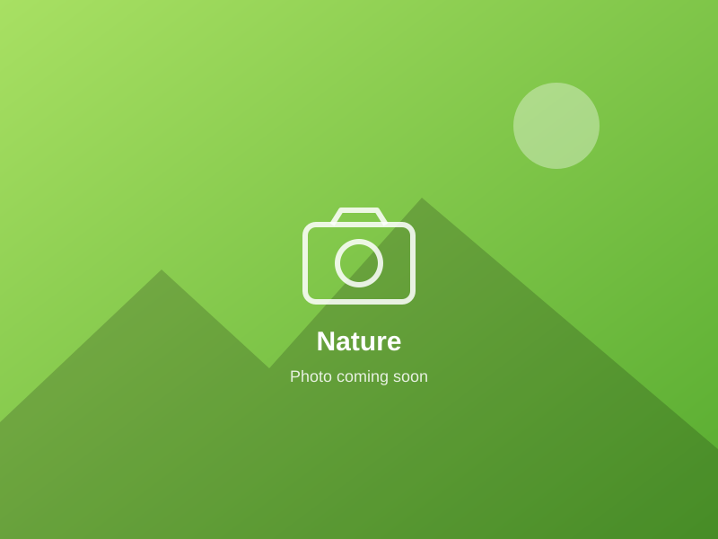
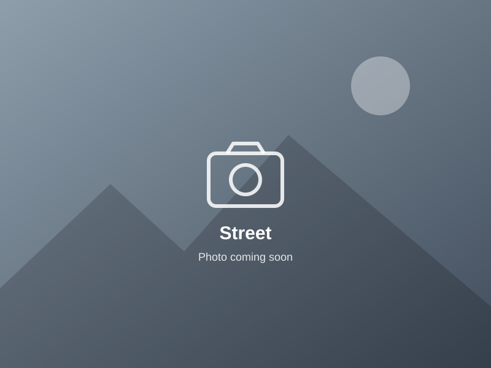
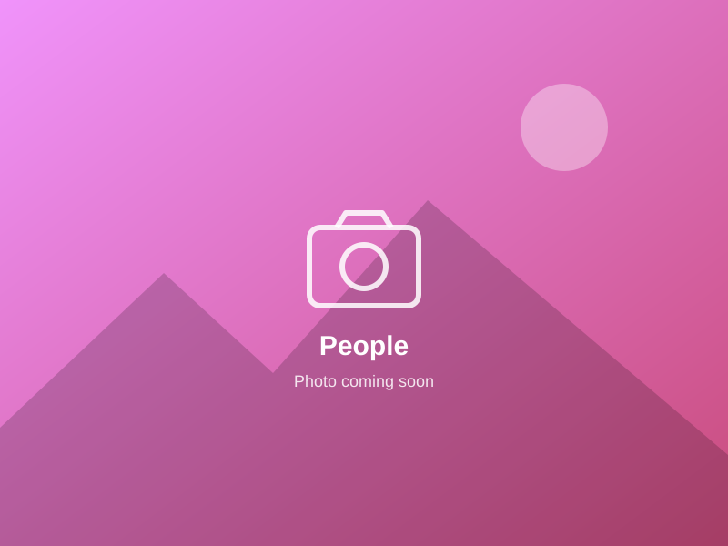
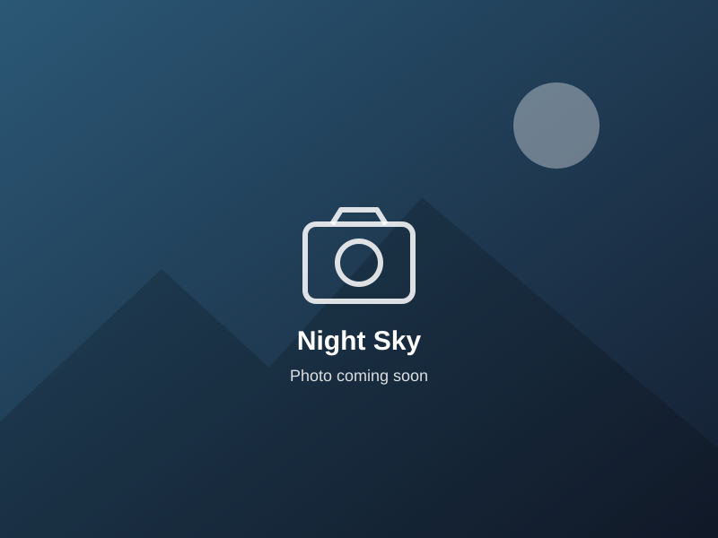
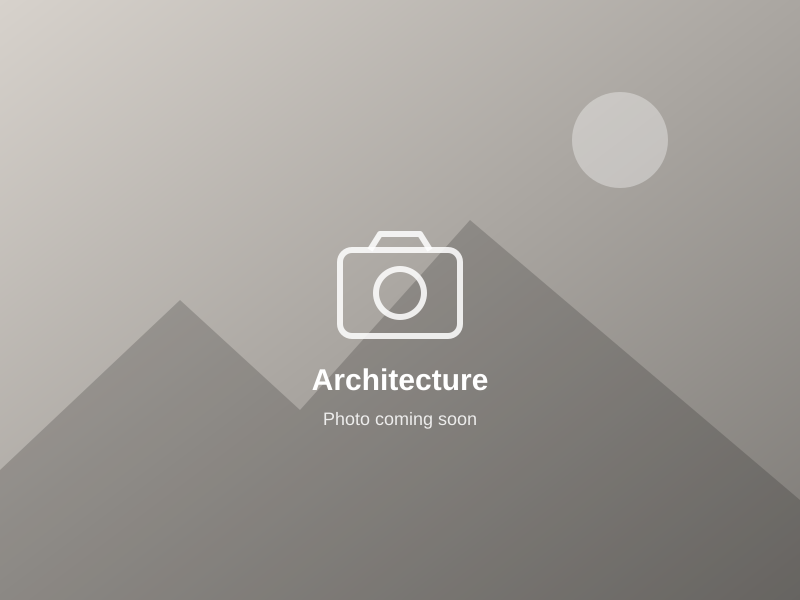
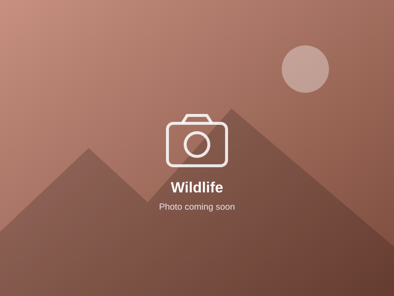
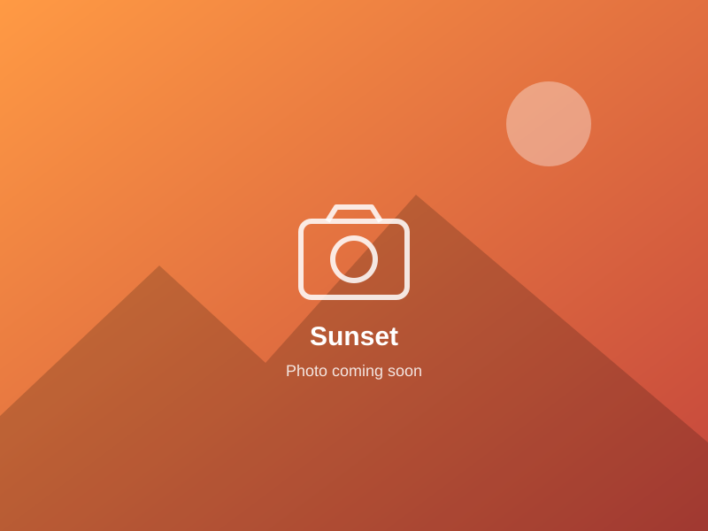

# Photography

Outside research, I enjoy photography: landscapes, everyday street scenes, and the places I travel to. This gallery is a small collection of moments that caught my eye.

<!-- To add a photo: put the image in docs/Images/photography/ and replace a placeholder's src, alt and caption below. -->

  <figure><figcaption>Landscape · Location, Year</figcaption></figure>
  <figure><figcaption>Nature · Location, Year</figcaption></figure>
  <figure><figcaption>Street · Location, Year</figcaption></figure>
  <figure><figcaption>Travel · Location, Year</figcaption></figure>
  <figure><figcaption>People · Location, Year</figcaption></figure>
  <figure><figcaption>Night Sky · Location, Year</figcaption></figure>
  <figure><figcaption>Architecture · Location, Year</figcaption></figure>
  <figure><figcaption>Wildlife · Location, Year</figcaption></figure>
  <figure><figcaption>Sunset · Location, Year</figcaption></figure>

  <!-- UA Logo -->
  

    
  

  <!-- Contact Info -->
  

    
<strong>Contact:</strong> 
    Mehedi Hasan 
    Email: <a href="mailto:mehedihasan@arizona.edu">mehedihasan@arizona.edu</a> 
    Phone: +1 (520) 269 5013

  

  <!-- Social Media -->
  

    
<strong>Connect:</strong>

    
    
    
        
        
  
 
  <strong><I>"I'm always open to meaningful research collaborations—feel free to reach out anytime!"<I></strong>

